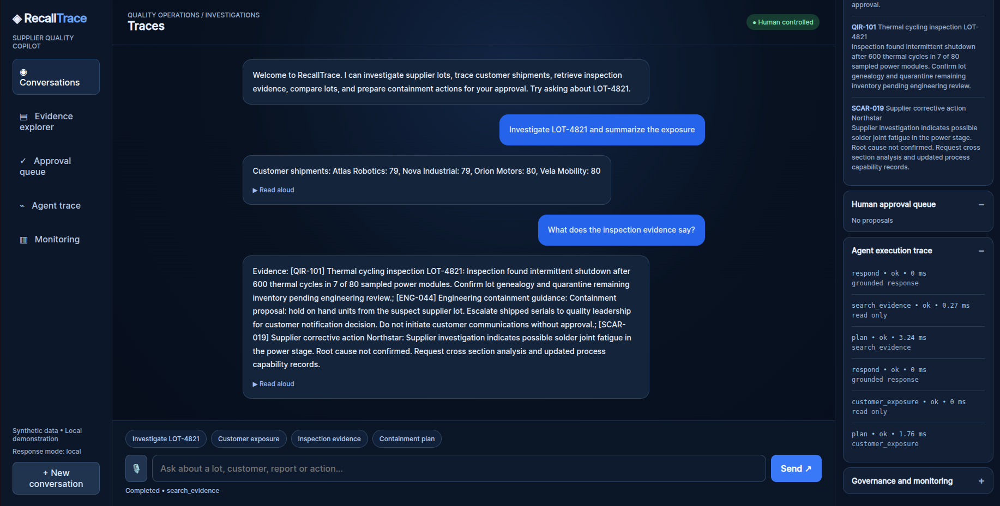
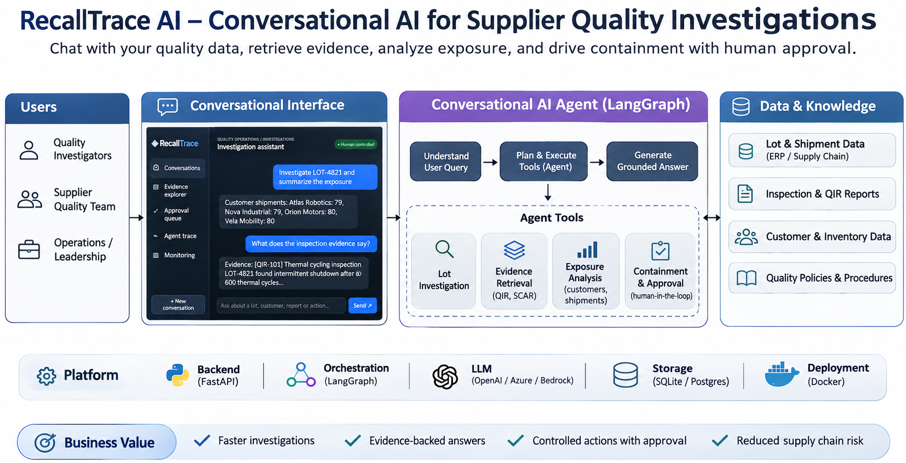
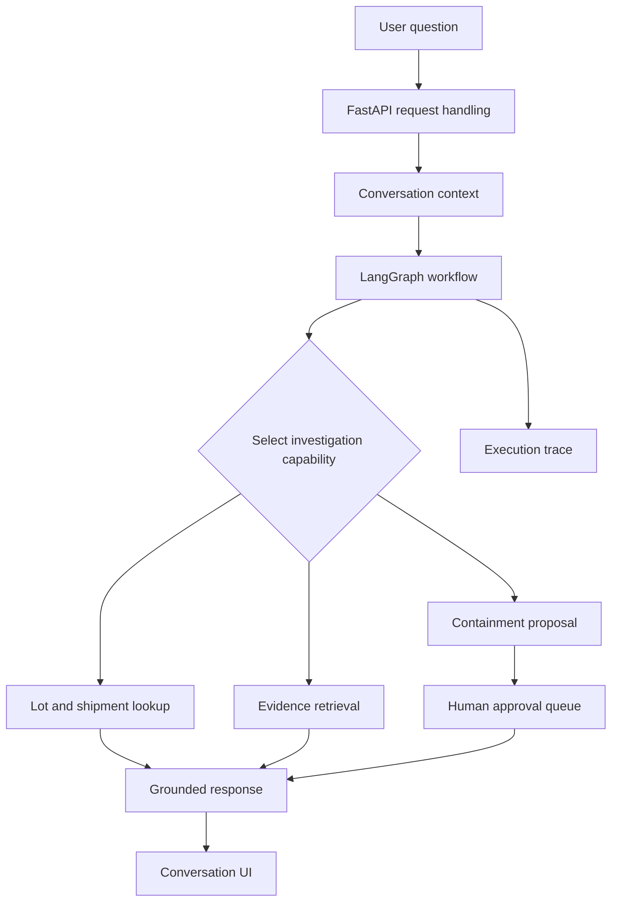

# RecallTrace AI

**A conversational investigation workspace for supplier quality and product traceability.**

RecallTrace helps quality and operations teams investigate a suspect supplier lot, trace affected units to customers and plants, inspect supporting records, and prepare containment proposals for human review. The interface is conversational, but the underlying workflow uses structured tools and traceable business data rather than relying on a model to invent answers.

> **Project status:** Local engineering demonstration with synthetic data. Not connected to live supplier, ERP, or customer systems. External communications and operational changes are not executed.

## Product preview



The workspace brings together the investigation conversation, supporting evidence, customer exposure, approval queue, and execution traces. Users can ask follow-up questions without navigating separate reports.

## Why this exists

A supplier quality issue often starts with a small amount of information: a suspect lot, a failed inspection, or a supplier corrective action. Determining the impact requires joining several sources of information and deciding what to do next.

RecallTrace demonstrates a focused workflow:

1. Investigate a supplier lot and determine the affected inventory.
2. Trace shipped units and identify customer exposure.
3. Retrieve inspection reports and supplier corrective action evidence.
4. Prepare proposed containment steps with a human approval gate.
5. Review the workflow trace and evidence supporting the response.

## Architecture



### Workflow design



**Key architectural decisions**

- **Structured tool access:** Investigation functions operate on known business records. Tool access is constrained to an allowlist.
- **Grounding and traceability:** Retrieved evidence is displayed with source identifiers, allowing users to inspect why a response was generated.
- **Stateful conversations:** Conversation history is stored locally with SQLite, supporting follow-up questions within a session.
- **Human oversight:** The system prepares proposals for review instead of silently executing operational changes.
- **Execution visibility:** Workflow steps expose status and timing information in the interface.
- **Model flexibility:** An optional LLM can support natural language responses. The demonstration also supports a local response mode without an external model.

## Implemented capabilities

| Area | What the demonstration provides |
| --- | --- |
| Conversational interface | Questions and follow-up investigation requests |
| Orchestration | LangGraph workflow execution |
| Tool use | Allowlisted investigation functions |
| Business grounding | Lot, shipment, customer, and inspection records |
| Evidence | Retrieval with source identifiers |
| Session history | SQLite-backed persistence |
| Human approval | Local review of proposed containment actions |
| Observability | Workflow steps, execution status, and elapsed time |
| Voice | Browser speech input and read-aloud where supported |
| API | FastAPI backend |

Some advanced capabilities, such as embedding-based retrieval, may depend on optional configuration. This table describes the local demonstration, not an independently verified production deployment.

## Example investigations

Start with one of the synthetic lots: `LOT-4821`, `LOT-7103`, or `LOT-9902`.

**Trace the exposure**

> Investigate LOT-4821 and summarize the customer exposure.

**Review supporting evidence**

> What does the thermal cycling inspection say about LOT-4821?

**Ask a follow-up**

> Which customers received units from that lot?

**Prepare a controlled response**

> What containment actions should we propose for review?

These examples are intended to demonstrate evidence-backed conversations and human decision points, not automated quality dispositions.

## Technology

**Backend:** Python, FastAPI, Pydantic

**Agent workflow:** LangGraph, LangChain core integrations

**Persistence:** SQLite

**Interface:** Browser-based conversational workspace

**Quality tooling:** pytest, Ruff

**Optional model integration:** Configurable LLM provider, with local demonstration mode

## Run locally

Requirements: Python 3.10+ and a supported modern browser.

```bash
git clone https://github.com/joel5638/recalltrace-ai.git
cd recalltrace-ai
python3 -m venv .venv
source .venv/bin/activate
pip install -r requirements.txt
uvicorn app.main:app --reload
```

Open **http://127.0.0.1:8000**.

The application uses synthetic demonstration records. Optional model credentials should be configured locally and never committed to the repository. See the project's configuration files for available environment variables.

## Project boundaries

RecallTrace is a portfolio demonstration, not a production quality management system. The local approval workflow does not update an ERP or notify customers. Authentication, enterprise identity, audit retention, secret management, security testing, infrastructure hardening, and production deployment controls require further work before operational use.

## Future engineering work

- Durable workflow interrupts and resume across process restarts
- Enterprise identity and role-based authorization
- Production-grade observability, evaluation, and audit trails
- Scalable vector retrieval and reranking infrastructure
- Real-time streaming speech with interruption handling
- Deployment automation, resilience testing, and governance controls

## Data and safety

All example suppliers, customers, lots, and inspections are synthetic. No real customer or supplier data is required to run the demonstration.
